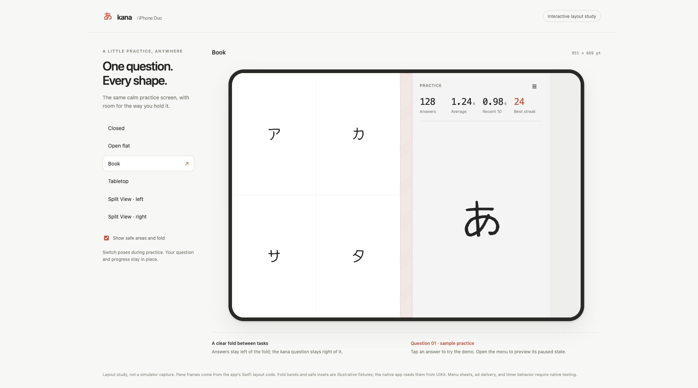
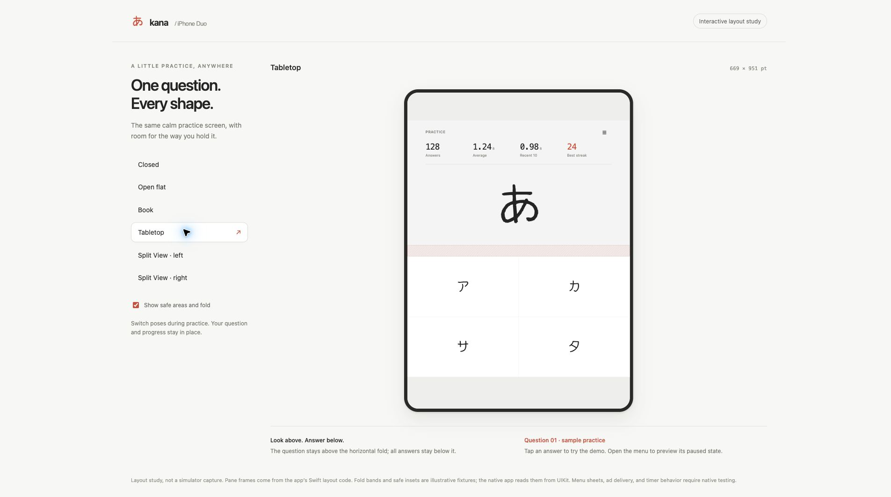

# iPhone Duo practice layout

Kana keeps one question, the same statistics, and all four answers through a
resize. Compact portrait stacks the question above the answers. A wide window
places the four answers on the leading side and the kana question on the trailing
side: answers on the left and the question on the right in left-to-right layouts.
A horizontal fold puts the question above the fold and the answers below it.

The implementation follows the readiness, adaptive layout, dual-pane patterns,
and design review skills from
[iphone-duo-skills](https://github.com/mirzaaghazadeh/iphone-duo-skills/tree/c3fa17c363ff555c16e44e3e94f16929fcab9646),
along with [Apple's preparation guide](https://developer.apple.com/iphone-duo/prepare/).

## Layout decisions

- Headers and menu controls follow each safe-area edge independently. On iOS 27.1
  and later, an occlusion region that accounts for a side inset lets the question
  and answers use the space below the status bar. Answer targets and banners
  avoid occlusions at their own height. Other safe-area insets remain in place.
  The background fills the window. App content does not use screen dimensions or
  device identifiers.
- On iOS 27.1 and later, the practice view reads reserved regions in
  `updateConstraints`, including inactive divisions. Their frames already include
  margins. The fold position comes from UIKit, not the center of the window.
- The practice view lays out both panes directly, so safe-area and reserved-region
  updates apply on cold launch as well as resize. Both parts remain visible.
  `UISplitArrangement` can hide its secondary item in closed landscape, which
  would hide the answers. System sheets remain responsible for chart and support
  presentation.
- A region that leaves a pane narrower than 240 points or shorter than 176 points
  uses the larger free area. These are content limits, not device dimensions.
  The question pane scrolls when its menu, statistics, and question do not fit.
  The glyph shrinks before scrolling is needed. The ad stays outside the scroll
  view, at the bottom of the question pane, so it remains fully visible.
- Layout changes keep the controller and practice state. Programmatic scroll
  changes do not close the menu or resume the timer. Ads use the question pane's
  available width; the chart uses its collection view's width. Answer grid size
  changes invalidate both the layout and its cached cell sizes.
- iPhone landscape is enabled. The deployment target remains iOS 15; the build
  uses Xcode 27.2 and its SDK. Earlier systems use size classes and safe areas.

## Review preview

Serve this folder, then open the printed local URL:

```sh
python3 -m http.server 8800 --directory design/iphone-duo
```

The preview covers closed, open flat, book, tabletop, and both Split View sides.
Its rectangles are exported from the production `PracticeLayout` implementation.
Device dimensions, safe insets, and fold bands are review fixtures. They are not
constants in the app. This study uses rectangular safe areas; it does not model
the native app's per-row occlusion handling. The font subset comes from the
existing practice preview.
Answer taps advance sample data; the HTML does not reproduce native timer or ad
behavior.

**These images show the HTML study, not a running iOS app.**

| Book | Tabletop |
| --- | --- |
|  |  |

Regenerate the pane fixtures after a layout change:

```sh
mkdir -p build
swiftc source/kana/kana/views/layouts/PracticeLayout.swift \
  scripts/export-duo-layouts.swift -o build/export-duo-layouts
build/export-duo-layouts > design/iphone-duo/layouts.json
```

## Validation

Checked on 2026-11-02:

- `python3 scripts/test-practice-layout.py`: 10 production geometry tests passed
  on macOS, including physical fold positions, inactive folds, RTL, asymmetric
  remaining space, and short landscape windows.
- Xcode 27.2 `build-for-testing` for the generic iOS Simulator destination passed.
  This compiled the app, unit tests, and UI tests, including five new UIKit resize
  tests for active/paused timers, question state, safe areas, and chart sizing.
- Browser review: all six poses retained sample question, answer count, progress,
  and menu state. The preview also fit a 390-point browser viewport without
  horizontal overflow. No browser warnings or errors were observed.
- Native regression tests passed on iPhone 18 Pro, iOS 27.0: 10 geometry tests,
  five UIKit resize tests, and the menu pause/resume test. The safe-area test
  waits for the host scene and allows one device pixel for UIKit rounding.

Checked on 2026-11-17 after the side-occlusion fix:

- `python3 scripts/test-practice-layout.py`: all 18 geometry tests passed.
- iPhone Duo, iOS 27.1: all 38 selected unit tests and three UI tests passed.
  Coverage includes delayed reserved regions, banner visibility, cell sizes after
  resize, timer state, both landscape rotations, and chart/support presentation.
- iPhone 18 Pro, iOS 27.0: 37 selected unit tests passed; the iOS 27.1 reserved-region
  test was skipped. The first run encountered the simulator's tracking permission
  prompt. The suite passed after dismissing it.
- Native visual review covered cold launch, closed portrait, open flat, book,
  tabletop, and live folding. The prompt stays centered, the banner stays visible,
  and all four answers use the space below the side status bar.

Further native validation remains for both Split View sides, PiP
height changes, VoiceOver navigation, localized layout, and physical devices.

Run the regression suite or repeat it on a Duo runtime:

```sh
xcodebuild test -project source/kana/kana.xcodeproj -scheme kana \
  -destination 'platform=iOS Simulator,id=SIMULATOR_UDID'
```
