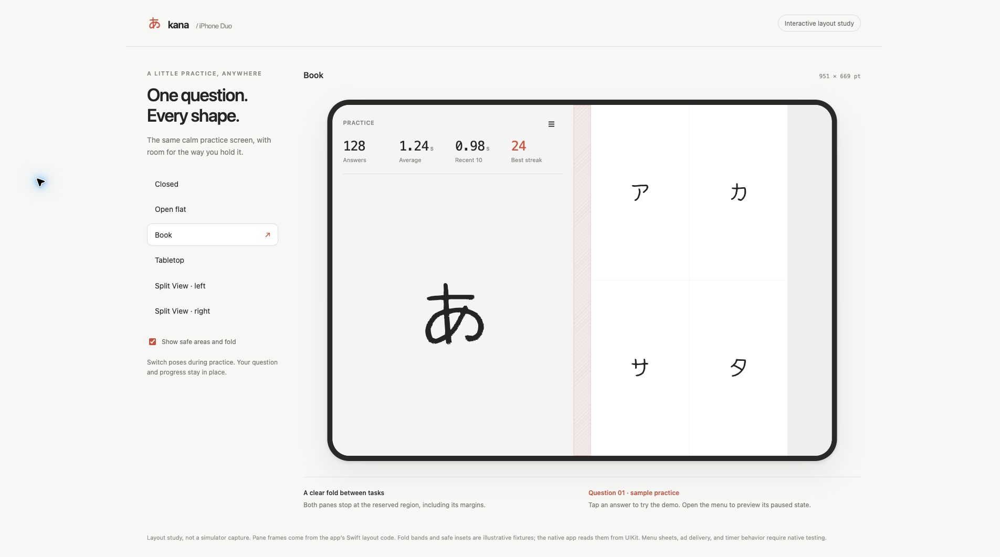
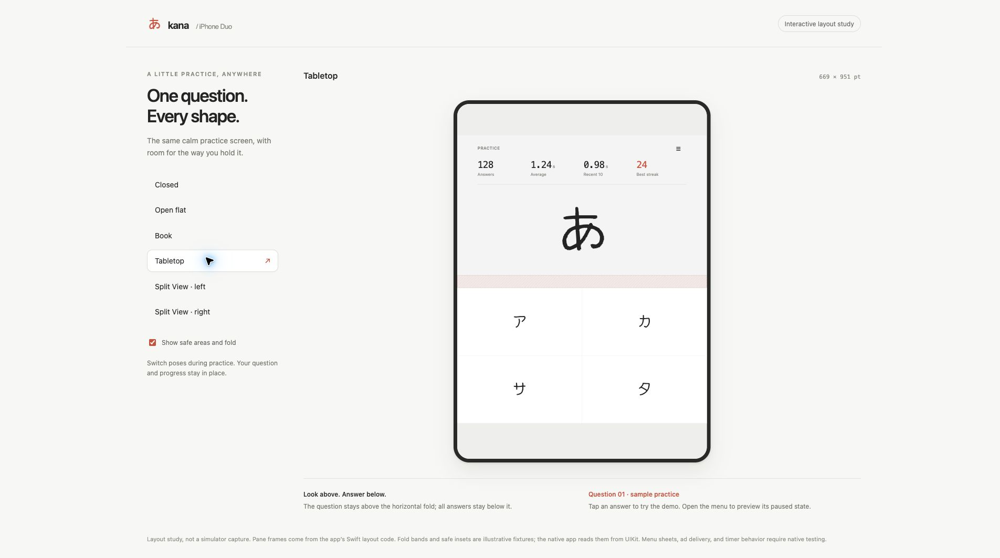

# iPhone Duo practice layout

Kana keeps one question, the same statistics, and all four answers through a
resize. Compact portrait stacks the question above the answers. A wide window
uses two columns. A horizontal fold puts the question above the fold and the
answers below it.

The implementation follows the readiness, adaptive layout, dual-pane patterns,
and design review skills from
[iphone-duo-skills](https://github.com/mirzaaghazadeh/iphone-duo-skills/tree/c3fa17c363ff555c16e44e3e94f16929fcab9646),
along with [Apple's preparation guide](https://developer.apple.com/iphone-duo/prepare/).

## Layout decisions

- The foreground follows each safe-area edge independently. The background fills
  the window. App content does not use screen dimensions or device identifiers.
- On iOS 27.1 and later, the content view reads division regions in
  `updateConstraints`, including inactive regions. Their frames already include
  margins. The fold position comes from UIKit, not the center of the window.
- A custom two-pane container keeps both parts of the exercise visible.
  `UISplitArrangement` can hide its secondary item in closed landscape, which
  would hide the answers. System sheets remain responsible for chart and support
  presentation.
- A region that leaves a pane narrower than 240 points or shorter than 176 points
  uses the larger free area. These are content limits, not device dimensions.
  The question pane scrolls when its menu, statistics, question, and ad do not fit.
- Layout changes keep the controller and practice state. Programmatic scroll
  changes do not close the menu or resume the timer. Ads use the question pane's
  current width; the chart uses its collection view's width.
- iPhone landscape is enabled. The deployment target remains iOS 15; the build
  uses Xcode 27.2 and its SDK. Earlier systems use size classes and safe areas.

## Review preview

Serve this folder, then open the printed local URL:

```sh
python3 -m http.server 8800 --directory design/iphone-duo
```

The preview covers closed, open flat, book, tabletop, and both Split View sides.
Its rectangles are exported from the production `PracticeLayout` implementation.
Device dimensions, safe insets, and fold bands are review fixtures. They are not
constants in the app. The font subset comes from the existing practice preview.
Answer taps advance sample data; the HTML does not reproduce native timer or ad
behavior.

**These images show the HTML study, not a running iOS app.**

| Book | Tabletop |
| --- | --- |
|  |  |

Regenerate the pane fixtures after a layout change:

```sh
mkdir -p build
swiftc source/kana/kana/views/layouts/PracticeLayout.swift \
  scripts/export-duo-layouts.swift -o build/export-duo-layouts
build/export-duo-layouts > design/iphone-duo/layouts.json
```

## Validation

Checked on 2026-11-02:

- `python3 scripts/test-practice-layout.py`: 10 production geometry tests passed
  on macOS, including physical fold positions, inactive folds, RTL, asymmetric
  remaining space, and short landscape windows.
- Xcode 27.2 `build-for-testing` for the generic iOS Simulator destination passed.
  This compiled the app, unit tests, and UI tests, including five new UIKit resize
  tests for active/paused timers, question state, safe areas, and chart sizing.
- Browser review: all six poses retained sample question, answer count, progress,
  and menu state. The preview also fit a 390-point browser viewport without
  horizontal overflow. No browser warnings or errors were observed.
- Native test execution was attempted but did not start: Xcode disabled Simulator
  support because installed CoreSimulator 1171.7.0 is older than its required
  1174.21.0. `test-without-building` exited 70 with no matching destination.

Native validation remains open before release: all Duo poses and rotations,
live folding during a question, both Split View sides, PiP height changes,
VoiceOver, localized statistics, and chart/support/ad presentation. The browser
preview and host geometry tests do not validate UIKit layout or real fold events.

After a matching runtime is available:

```sh
xcodebuild test -project source/kana/kana.xcodeproj -scheme kana \
  -destination 'platform=iOS Simulator,id=SIMULATOR_UDID'
```
