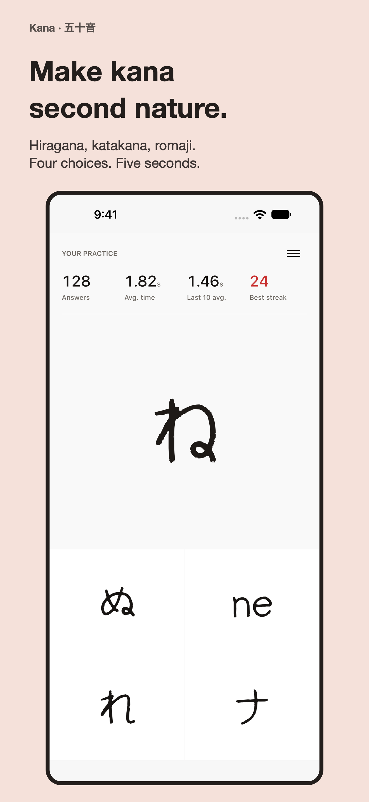
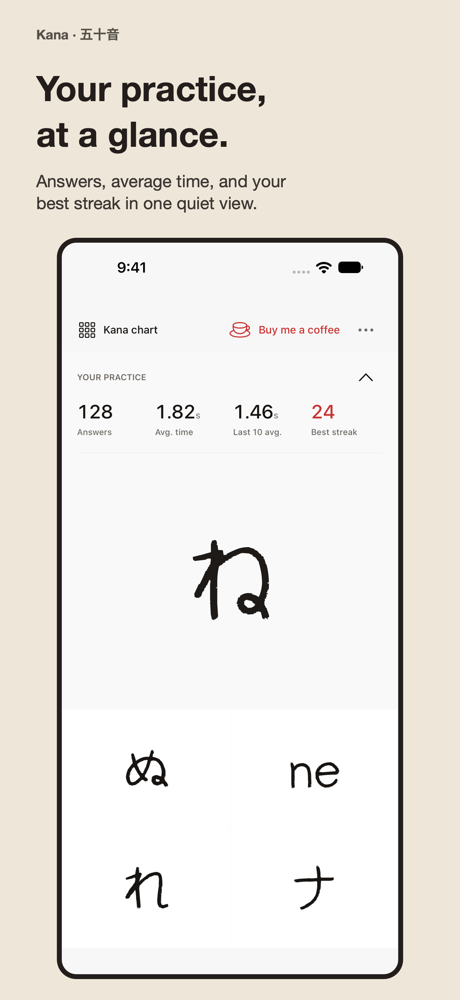
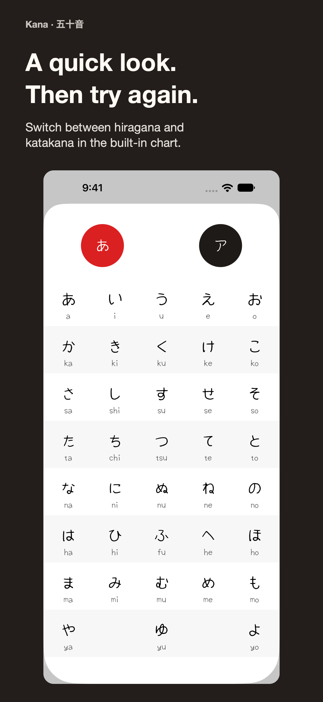
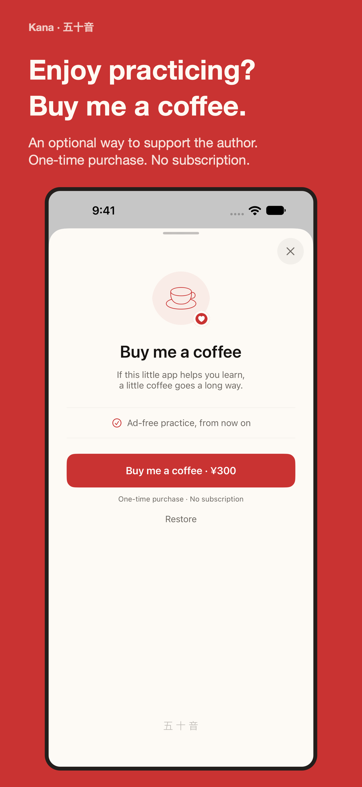

# App Store metadata

`metadata.json` contains the descriptions, promotional text, release notes, and
screenshot captions for version 1.1.0 in English, Japanese, Simplified Chinese,
Traditional Chinese, and Korean. The store copy is saved in App Store Connect.
The `appName` field is the label on the artwork; it does not rename the app.
The English store name is `Japanese kana - learning`, with the subtitle
`Challenge yourself`. Both fit the current 30-character limits.

The public App Store version is **1.1.0 (17)**, released on October 6, 2026.
It contains the practice and coffee redesign and fixes unreadable kana chart
text in Dark Mode. The app and its first coffee purchase were submitted
together on September 27, 2026, with automatic release after approval.

The store copy focuses on timed questions and the best correct-answer streak.
It explains that ads appear only after an incorrect answer or a timeout. Coffee
support is presented as an optional way to support the author.

## TestFlight 1.1.1 (18)

Uploaded on November 2, 2026. App Store Connect reports `VALID` and
`IN_BETA_TESTING` for build `e1c0369f-38dd-4e03-9981-c5f413149888`. The existing
internal group has access to all builds. English, Japanese, and Simplified
Chinese test notes were saved and read back. This build adds the adaptive
iPhone Duo layout, with answers on the left and the kana question on the right
in wide left-to-right layouts.

The build passed Apple validation and all 16 native regression tests on
iPhone 18 Pro with iOS 27.0. Actual Duo division events and device behavior
still need testing on an iOS 27.1 or later Duo runtime. See the
[Duo validation notes](../design/iphone-duo/README.md).

The signed archive is stored outside the worktree at
`~/Library/Developer/Xcode/Archives/2026-11-02/Kana 1.1.1 (18) - Duo.xcarchive`.
The IPA, export options, upload logs, and status records are in
`~/Library/Developer/Kana/releases/2026-11-02-1.1.1-18/`.
The machine-local `release-settings.json` references the shared App Store
Connect API credential used by Meow.

Use `xcodebuild archive` with signing enabled, then `xcodebuild -exportArchive`
with method `app-store-connect`, destination `upload`, automatic signing, and
`uploadSymbols = true`. Supply the API key path, key ID, and issuer from the
local settings file to both commands. An unsigned archive preserved an invalid
GoogleMobileAds signature identifier and failed Apple validation; the signed
archive passed. Apple reported missing vendor SDK dSYMs during upload, but
accepted the build. The app's own dSYM matches its executable.

## Screenshots

The layout follows Menkyo: a large headline, one short benefit, and an unchanged
native capture inside a frame. Warm paper, pale pink, ink, and red keep Kana's
visual style. The four images introduce practice, statistics, the kana chart,
and the optional coffee purchase, in that order.

| Practice | Statistics | Kana chart | Coffee support |
| --- | --- | --- | --- |
|  |  |  |  |

The 40 store images cover five languages and two sizes: iPhone 18 Pro Max
(1320 × 2868) and iPad Pro 13-inch (2064 × 2752). They use fixed sample statistics
and a local StoreKit price in the Japanese storefront. The IAP review screenshot
uses the native coffee screen without the marketing frame.

## Generate the preview

Capture the real app with `scripts/capture-design.py --store-listing`. Place the
outputs in `CAPTURE_ROOT/LANGUAGE/DEVICE`, where `LANGUAGE` is `en`, `ja`,
`zh-Hans`, `zh-Hant`, or `ko`, and `DEVICE` is `iphone` or `ipad`.
Use simulators with the dimensions above and a new directory for each capture.

```sh
python3 scripts/capture-design.py \
  --device IPHONE_SIMULATOR_UDID \
  --language en \
  --store-listing \
  --output build/store-native/en/iphone

# After capturing both devices in all five languages:
swift scripts/render-store.swift \
  store/metadata.json build/store-native build/store-marketing
python3 -m http.server 8797 --directory build/store-marketing
```

Open `http://localhost:8797` to review all languages and both devices. Each image
links to its full-size PNG. The page also shows the promotional text, description,
and release notes from the same metadata file.

The renderer requires macOS and AppKit. It checks source dimensions and text fit,
writes opaque RGB PNGs, and saves font sizes and source paths in `layout.json`.
The generated bundle includes `index.html`, `metadata.json`, and `screenshots/`.
Only the four English samples are committed; the full bundle stays in `build/`.

## Validation

All 40 images passed the size, opacity, and text-fit checks and were reviewed in
the browser. The preview was checked at desktop width and at 390 px and 320 px.
App Store Connect reports all 40 screenshot uploads as `COMPLETE`; the saved
descriptions, promotional text, and release notes match `metadata.json`.

The kana chart fix was checked on iPhone in Light and Dark Mode, and on iPad in
Dark Mode. All three capture tests passed and produced complete result bundles.

App Privacy labels are published. The final descriptions, promotional text, and
release notes were read back from App Store Connect and match `metadata.json`.
The ten updated coffee images passed layout, dimension, and opacity checks.
All 40 screenshots have the expected checksums and order and report `COMPLETE`.

[App Review submission](https://appstoreconnect.apple.com/apps/1195345471/distribution/reviewsubmissions/details/85c4f677-85ad-4bfe-a944-ca6a7ec9a0f4)
contains both version 1.1.0 (17) and `com.salmonapps.app.kana.coffee`.
